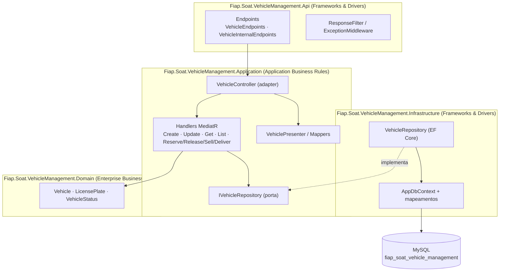
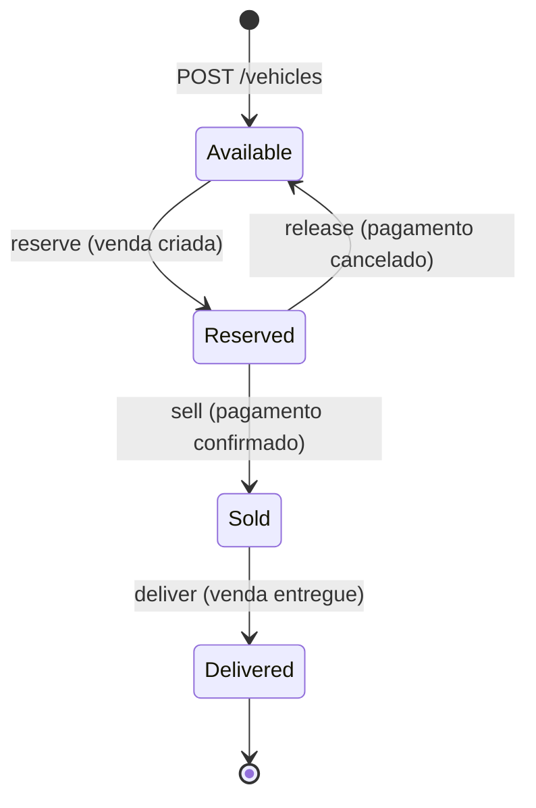
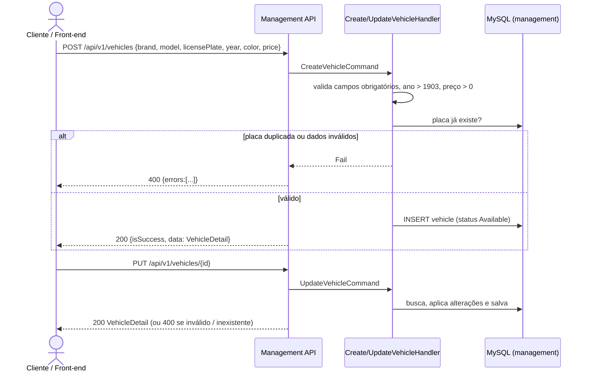
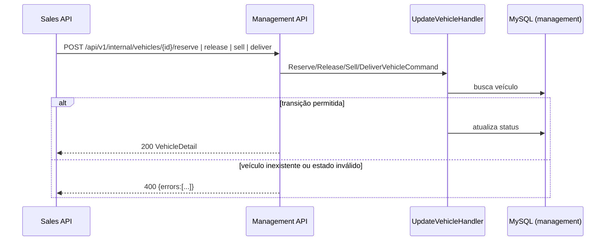
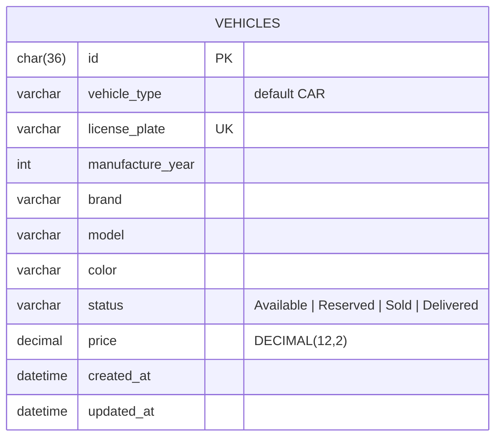
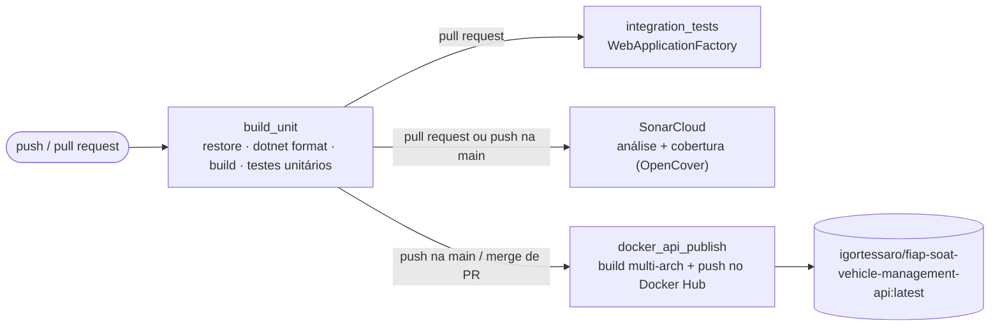

# soat-vehicle-management

Serviço principal da plataforma de revenda de veículos (Tech Challenge SOAT — Fase 4).

Ele é a **fonte oficial dos dados e do estado dos veículos**: cadastra e edita veículos, expõe as listagens ordenadas por preço e controla as transições de estado (`Available → Reserved → Sold → Delivered`) solicitadas pelo serviço de vendas. Os dados ficam em um **MySQL exclusivo**, separado do banco do serviço de vendas.

> 📘 Visão geral da solução completa, fluxo ponta a ponta e roteiro de demonstração: [docs/SOLUTION-OVERVIEW.md](docs/SOLUTION-OVERVIEW.md)
>
> Repositório do serviço de vendas: [igortessaro/soat-vehicle-sales](https://github.com/igortessaro/soat-vehicle-sales)

## Sumário

- [Responsabilidades](#responsabilidades)
- [Tecnologias](#tecnologias)
- [Arquitetura](#arquitetura)
- [Fluxos](#fluxos)
- [API](#api)
- [Modelo de dados](#modelo-de-dados)
- [Como executar localmente](#como-executar-localmente)
- [Como testar](#como-testar)
- [CI/CD e qualidade](#cicd-e-qualidade)

## Responsabilidades

| Faz | Não faz |
| --- | --- |
| Cadastrar veículo (marca, modelo, placa, ano, cor, preço) | Registrar vendas ou compradores |
| Editar os dados do veículo | Processar pagamentos |
| Listar veículos (todos, disponíveis e vendidos), ordenados por preço crescente | Acessar o banco do serviço de vendas |
| Reservar, liberar, vender e entregar um veículo (endpoints internos) | |

## Tecnologias

| Categoria | Tecnologia |
| --- | --- |
| Linguagem / runtime | C# · .NET 10 |
| API | ASP.NET Core Minimal APIs, OpenAPI + [Scalar](https://scalar.com/) (ambiente `Development`) |
| Casos de uso | MediatR 14 (commands/queries + handlers), FluentResults (resultado sem exceções) |
| Persistência | Entity Framework Core 9 + Pomelo (MySQL), MySQL 8.4 |
| Migrations | Flyway (scripts SQL versionados em `database/migrations`) |
| Observabilidade | Health checks (`/health`) da API e do banco |
| Containers | Docker (imagem multi-stage) e Docker Compose |
| Testes | NUnit 4, Moq, Bogus, EF Core InMemory, ASP.NET Core TestHost / `WebApplicationFactory`, coverlet |
| CI/CD e qualidade | GitHub Actions, SonarCloud, Docker Hub |

## Arquitetura

O código segue **Clean Architecture**: as dependências apontam sempre para dentro, e o domínio não conhece nenhum framework.



```text
src/
├── Fiap.Soat.VehicleManagement.Domain          # Entidades, value objects e regras de estado
├── Fiap.Soat.VehicleManagement.Application     # Casos de uso (MediatR), controllers, presenters, portas
├── Fiap.Soat.VehicleManagement.Infrastructure  # EF Core, repositórios, mapeamentos
└── Fiap.Soat.VehicleManagement.Api             # Endpoints HTTP, filtros, middleware, Program
tests/
├── *.Domain.Tests · *.Application.Tests · *.Infrastructure.Tests · *.Api.Tests   # unitários
└── *.Integration.Tests                                                           # API completa em memória
database/migrations/                            # Scripts Flyway
```

### Decisões principais

- **HTTP síncrono entre serviços.** O serviço de vendas chama os endpoints `internal` para alterar o estado do veículo. Não há broker de mensagens.
- **Regras de transição no próprio serviço.** Os handlers validam o estado atual antes de cada transição; o serviço de vendas só envia a intenção (`reserve`, `sell`…).
- **Respostas padronizadas.** Os casos de uso devolvem `Response<T>` (FluentResults). O `ResponseFilter` converte falhas em `400 Bad Request` com `{ "errors": [...] }`.

## Fluxos

### Máquina de estados do veículo



As operações são idempotentes no estado de destino: reservar um veículo já `Reserved`, por exemplo, é aceito. Qualquer outra transição devolve `400` com a mensagem da regra.

### Cadastro e edição



### Transições solicitadas pelo serviço de vendas



## API

Todas as rotas usam o prefixo `/api/v1`. A documentação interativa fica em `/scalar/v1` (somente em `Development`).

| Método | Rota | Descrição |
| --- | --- | --- |
| `POST` | `/vehicles` | Cadastra um veículo (`status = Available`) |
| `PUT` | `/vehicles/{id}` | Edita marca, modelo, placa, ano, cor e preço |
| `GET` | `/vehicles/{id}` | Consulta um veículo |
| `GET` | `/vehicles` | Lista com filtros opcionais (`LicensePlate`, `Brand`, `Model`, `Year`, `Color`, `Status`), ordenado por preço |
| `GET` | `/vehicles/available` | Veículos à venda, do mais barato para o mais caro |
| `GET` | `/vehicles/sold` | Veículos vendidos (`Sold` e `Delivered`), do mais barato para o mais caro |
| `POST` | `/internal/vehicles/{id}/reserve` | `Available → Reserved` (uso do serviço de vendas) |
| `POST` | `/internal/vehicles/{id}/release` | `Reserved → Available` |
| `POST` | `/internal/vehicles/{id}/sell` | `Reserved → Sold` |
| `POST` | `/internal/vehicles/{id}/deliver` | `Sold → Delivered` |
| `GET` | `/health` (sem prefixo) | Saúde da API e do banco |

Exemplo de cadastro:

```bash
curl -X POST http://localhost:5180/api/v1/vehicles \
  -H 'Content-Type: application/json' \
  -d '{"brand":"Toyota","model":"Corolla","licensePlate":"BRA1A19","year":2020,"color":"Prata","price":150000}'
```

```json
{
  "isSuccess": true,
  "data": {
    "id": "08df3385-0f0a-4702-8b53-0fe8cda58559",
    "brand": "Toyota", "model": "Corolla", "licensePlate": "BRA1A19",
    "year": 2020, "color": "Prata", "price": 150000, "status": "Available",
    "createdAt": "2026-10-26T17:17:48.58Z", "updatedAt": "2026-10-26T17:17:48.58Z"
  },
  "reasons": []
}
```

Falhas de regra de negócio devolvem `400`:

```json
{ "errors": [ { "message": "Vehicle with this license plate already exists", "metadata": {} } ] }
```

## Modelo de dados



O índice `idx_vehicle_status_price (status, price)` atende diretamente às listagens por status ordenadas por preço. O schema é criado pelo Flyway a partir de [`database/migrations`](database/migrations).

## Como executar localmente

### Pré-requisitos

- Docker e Docker Compose
- .NET SDK 10 (apenas para rodar sem Docker ou executar os testes)

### Somente este serviço (Docker Compose)

```bash
cp .env.example .env
docker compose up --build
```

| Recurso | Endereço |
| --- | --- |
| API | <http://localhost:5180> |
| Scalar (documentação interativa) | <http://localhost:5180/scalar/v1> |
| Health check | <http://localhost:5180/health> |
| MySQL | `localhost:3307` (usuário e senha no `.env`) |

O Compose sobe o MySQL, executa as migrations do Flyway e inicia a API.

Para cadastrar 55 veículos de exemplo: `./scripts/seed-vehicles.sh` ([detalhes](docs/SOLUTION-OVERVIEW.md#5-roteiro-de-demonstração-e2e)). A collection do Postman com todas as requisições está em [`docs/postman/`](docs/postman/).

### Solução completa

O ambiente completo da demonstração (dois serviços, dois bancos e o gateway de pagamento) é iniciado pelo `docker-compose.yml` do repositório [soat-vehicle-sales](https://github.com/igortessaro/soat-vehicle-sales). O passo a passo está em [docs/SOLUTION-OVERVIEW.md](docs/SOLUTION-OVERVIEW.md#4-como-executar-a-solução-completa).

### Sem Docker

Com um MySQL acessível e o schema criado:

```bash
ConnectionStrings__MySql="server=localhost;port=3307;database=fiap_soat_vehicle_management;user=vehicle_user;password=vehicle_pass" \
  dotnet run --project src/Fiap.Soat.VehicleManagement.Api
```

## Como testar

```bash
# Todos os testes (unitários + integração)
dotnet test Fiap.Soat.VehicleManagement.slnx

# Cobertura (relatório OpenCover em ./coverage)
dotnet test Fiap.Soat.VehicleManagement.slnx --settings coverlet.runsettings \
  --collect:"XPlat Code Coverage" --results-directory ./coverage
```

| Projeto de testes | Escopo | Testes |
| --- | --- | --- |
| `Domain.Tests` | Entidade `Vehicle`, value object `LicensePlate` | 16 |
| `Application.Tests` | Handlers, controller, presenters e mappers (dependências mockadas) | 49 |
| `Infrastructure.Tests` | Repositório com EF Core InMemory | 12 |
| `Api.Tests` | Endpoints (TestHost), filtro, middleware, health check | 34 |
| `Integration.Tests` | API completa via `WebApplicationFactory` + EF InMemory: cadastro, edição, listagens, transições e health | 31 |

Os testes de integração sobem a API inteira em memória, substituindo apenas o MySQL pelo EF Core InMemory. Não é preciso Docker para executá-los.

Cobertura no SonarCloud: **97,5%** ([painel do projeto](https://sonarcloud.io/project/overview?id=igortessaro_soat-vehicle-management)). Classes sem lógica testável (`Program`, `AppDbContext`, registros de DI, wrappers de `Response`) usam `[ExcludeFromCodeCoverage]` e estão listadas em `sonar.coverage.exclusions`.

## CI/CD e qualidade

O workflow [`.github/workflows/dotnet.yml`](.github/workflows/dotnet.yml) roda em pushes e em Pull Requests para `main`/`develop`:



- **Formatação:** `dotnet format --verify-no-changes` falha o build se o código não estiver formatado.
- **Qualidade:** a análise do SonarCloud recebe a cobertura em formato OpenCover gerada pelo coverlet.
- **Deploy:** o deploy da aplicação é a **publicação da imagem no Docker Hub** (`igortessaro/fiap-soat-vehicle-management-api:latest`). Ele roda automaticamente a cada merge de Pull Request na `main`, e qualquer ambiente com Docker passa a usar a nova versão com `docker compose pull && docker compose up -d`.
