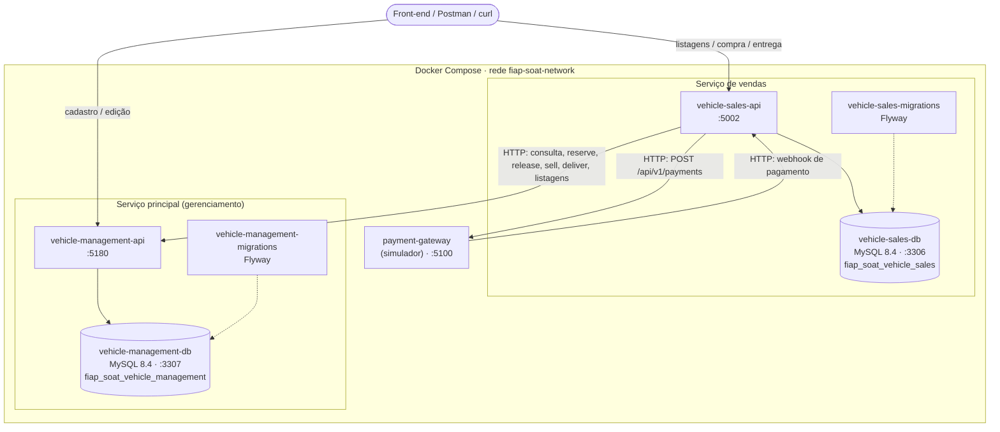
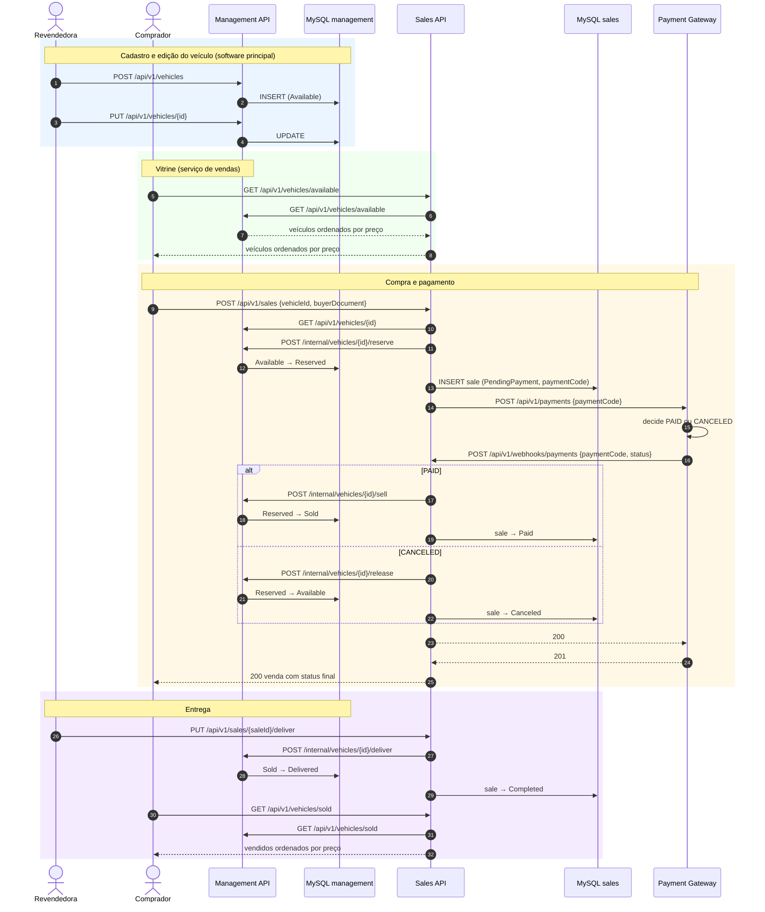
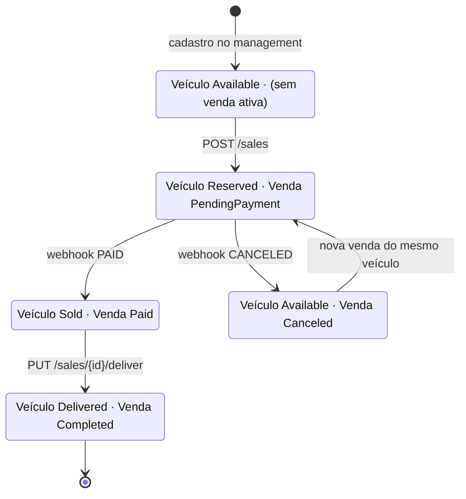
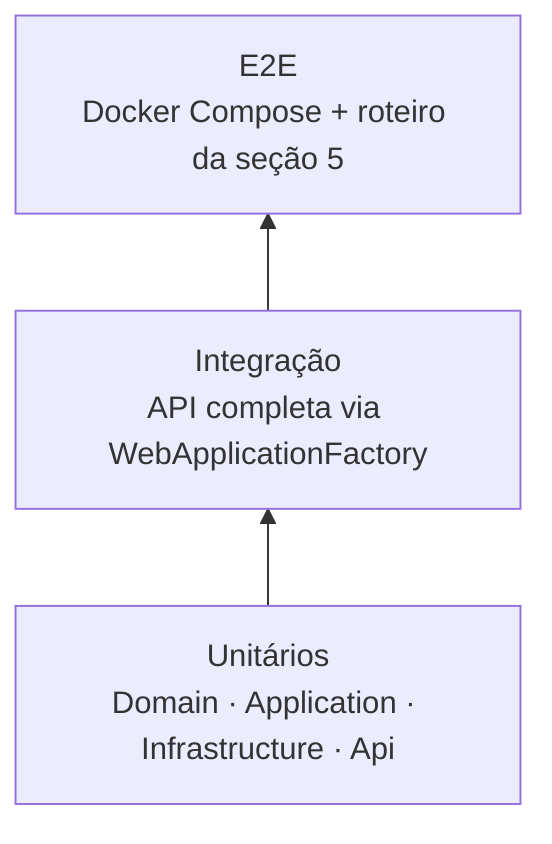
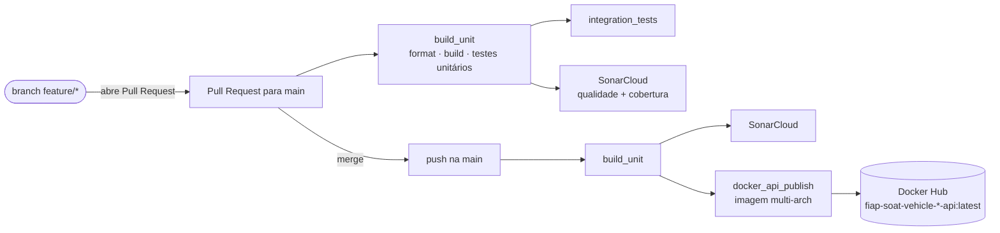

# Visão geral da solução — Revenda de veículos

Documentação do funcionamento geral da plataforma de revenda de veículos (Tech Challenge SOAT — Fase 4). Ela mostra como os serviços se dividem, como se comunicam e como executar e demonstrar o fluxo ponta a ponta: cadastro do veículo → compra → pagamento → entrega.

Os detalhes de cada serviço estão nos respectivos READMEs:

| Componente | Repositório | Papel |
| --- | --- | --- |
| Vehicle Management API | [soat-vehicle-management](https://github.com/igortessaro/soat-vehicle-management) | Software principal: cadastro, edição e estado oficial dos veículos |
| Vehicle Sales API | [soat-vehicle-sales](https://github.com/igortessaro/soat-vehicle-sales) | Serviço de venda: listagens, compra, pagamento e webhook |
| Payment Gateway (simulador) | imagem `igortessaro/fiap-soat-payment-gateway` | Processador de pagamento externo simulado |

## Sumário

1. [Contexto e requisitos](#1-contexto-e-requisitos)
2. [Arquitetura da solução](#2-arquitetura-da-solução)
3. [Fluxo ponta a ponta](#3-fluxo-ponta-a-ponta)
4. [Como executar a solução completa](#4-como-executar-a-solução-completa)
5. [Roteiro de demonstração E2E](#5-roteiro-de-demonstração-e2e)
6. [Cenários de erro](#6-cenários-de-erro)
7. [Testes, cobertura e qualidade](#7-testes-cobertura-e-qualidade)
8. [CI/CD](#8-cicd)
9. [Decisões e limitações conhecidas](#9-decisões-e-limitações-conhecidas)

## 1. Contexto e requisitos

Uma revendedora de veículos precisa de uma API para que o time de front-end construa a plataforma. A tabela abaixo mostra como cada necessidade do enunciado é atendida:

| Necessidade do negócio | Onde é atendida |
| --- | --- |
| Cadastrar veículo para venda (marca, modelo, ano, cor, preço) | Management · `POST /api/v1/vehicles` (também exige a placa) |
| Editar os dados do veículo | Management · `PUT /api/v1/vehicles/{id}` |
| Efetuar a venda (CPF do comprador e data da venda) | Sales · `POST /api/v1/sales`: valida o CPF/CNPJ e registra `createdAt` como data da venda |
| Webhook para o processador informar pagamento efetuado ou cancelado, pelo código do pagamento | Sales · `POST /api/v1/webhooks/payments` (`paymentCode` + `status` `PAID`/`CANCELED`) |
| Listagem de veículos à venda, do mais barato para o mais caro | Sales · `GET /api/v1/vehicles/available` |
| Listagem de veículos vendidos, do mais barato para o mais caro | Sales · `GET /api/v1/vehicles/sold` |
| Listagens e compras isoladas em um serviço único, com banco isolado | Serviço de vendas próprio, com o MySQL `fiap_soat_vehicle_sales` |
| Comunicação entre o serviço de vendas e o software principal via HTTP | `IHttpClientFactory` → endpoints `/api/v1/internal/vehicles/...` do management |
| Testes automatizados com cobertura de pelo menos 80% | Sales 98,6% · Management 97,5% (SonarCloud) |

## 2. Arquitetura da solução

### Visão de containers



Cada serviço tem um banco próprio, e nenhum acessa o banco do outro. Toda integração passa pelas APIs HTTP.

### Contratos entre os serviços

| Origem → destino | Chamada | Quando |
| --- | --- | --- |
| Sales → Management | `GET /api/v1/vehicles/{id}` | Validar se o veículo existe antes da venda |
| Sales → Management | `POST /api/v1/internal/vehicles/{id}/reserve` | Ao criar a venda (`Available → Reserved`) |
| Sales → Gateway | `POST /api/v1/payments` `{paymentCode}` | Logo após registrar a venda |
| Gateway → Sales | `POST /api/v1/webhooks/payments` `{paymentCode, status}` | Resultado do pagamento |
| Sales → Management | `POST /api/v1/internal/vehicles/{id}/sell` | Webhook `PAID` (`Reserved → Sold`) |
| Sales → Management | `POST /api/v1/internal/vehicles/{id}/release` | Webhook `CANCELED` (`Reserved → Available`) |
| Sales → Management | `POST /api/v1/internal/vehicles/{id}/deliver` | Entrega da venda (`Sold → Delivered`) |
| Sales → Management | `GET /api/v1/vehicles/available` e `/sold` | Listagens públicas do serviço de vendas |

### Arquitetura interna

Os dois serviços seguem **Clean Architecture** com as mesmas camadas (`Domain`, `Application`, `Infrastructure`, `Api`) e as mesmas tecnologias: .NET 10, Minimal APIs, MediatR, FluentResults, EF Core 9 + MySQL 8.4 e Flyway. Os diagramas de camadas, os modelos de dados e as tabelas de endpoints estão nos READMEs de cada repositório.

## 3. Fluxo ponta a ponta

### Sequência completa: cadastro → compra → pagamento → entrega



### Estados combinados

Cada serviço controla apenas o próprio estado. O serviço de vendas mantém os dois alinhados, porque só altera a venda depois que o management aceita a transição do veículo.



| Momento | Veículo (management) | Venda (sales) |
| --- | --- | --- |
| Veículo cadastrado | `Available` | — |
| Venda criada, pagamento em andamento | `Reserved` | `PendingPayment` |
| Pagamento confirmado | `Sold` | `Paid` |
| Pagamento cancelado | `Available` | `Canceled` |
| Veículo entregue | `Delivered` | `Completed` |

## 4. Como executar a solução completa

### Pré-requisitos

- Docker e Docker Compose
- Os dois repositórios clonados **lado a lado**, porque o Compose do serviço de vendas usa as migrations do management:

```bash
mkdir soat && cd soat
git clone https://github.com/igortessaro/soat-vehicle-management.git
git clone https://github.com/igortessaro/soat-vehicle-sales.git
```

### Subir o ambiente

```bash
cd soat-vehicle-sales
cp .env.example .env
docker compose up -d --build
```

Isso sobe os dois MySQL, aplica as migrations do Flyway e inicia as duas APIs e o simulador de pagamento.

| Serviço | URL | Documentação interativa |
| --- | --- | --- |
| Management API | <http://localhost:5180> | <http://localhost:5180/scalar/v1> |
| Sales API | <http://localhost:5002> | <http://localhost:5002/scalar/v1> |
| Payment Gateway | <http://localhost:5100> | — |

Para conferir se tudo subiu:

```bash
curl http://localhost:5180/health   # Management API + banco
curl http://localhost:5002/health   # Sales API + banco
curl http://localhost:5100/health   # Payment Gateway
```

## 5. Roteiro de demonstração E2E

Os exemplos abaixo foram executados contra o ambiente completo, e as respostas são reais (com campos abreviados).

### 5.1 Cadastrar veículos (management)

Cadastro individual:

```bash
curl -X POST http://localhost:5180/api/v1/vehicles \
  -H 'Content-Type: application/json' \
  -d '{"brand":"Toyota","model":"Corolla","licensePlate":"BRA1A19","year":2020,"color":"Prata","price":150000}'
```

```json
{ "isSuccess": true, "data": { "id": "08df3385-0f0a-4702-8b53-0fe8cda58559", "brand": "Toyota", "model": "Corolla", "price": 150000, "status": "Available" }, "reasons": [] }
```

Ou cadastre 55 veículos de exemplo com o script [`scripts/seed-vehicles.sh`](../scripts/seed-vehicles.sh):

```bash
./scripts/seed-vehicles.sh
# ou apontando para outra URL:
API_URL="http://localhost:5180/api/v1/vehicles" ./scripts/seed-vehicles.sh
```

### 5.2 Editar um veículo (management)

```bash
curl -X PUT http://localhost:5180/api/v1/vehicles/{id} \
  -H 'Content-Type: application/json' \
  -d '{"brand":"Toyota","model":"Corolla XEi","licensePlate":"BRA1A19","year":2020,"color":"Prata","price":145000}'
```

### 5.3 Listar veículos à venda (sales)

```bash
curl http://localhost:5002/api/v1/vehicles/available
```

A resposta vem ordenada por preço, do mais barato para o mais caro. Por exemplo: `59900 → 68900 → 82900 → 87900 → 145000 → 149900`.

### 5.4 Cadastrar o processador de pagamento (sales)

Esse passo só precisa ser feito uma vez por ambiente:

```bash
curl -X POST http://localhost:5002/api/v1/payment-gateways \
  -H 'Content-Type: application/json' \
  -d '{"name":"soat-payment-gateway","baseUrl":"http://payment-gateway:8080"}'
```

Uma segunda tentativa retorna `409 A payment gateway is already registered`.

### 5.5 Efetuar a compra (sales)

```bash
curl -X POST http://localhost:5002/api/v1/sales \
  -H 'Content-Type: application/json' \
  -d '{"vehicleId":"08df3385-0f21-4f14-8f13-b4680e9fefc9","buyerDocument":"529.982.247-25"}'
```

```json
{
  "isSuccess": true,
  "data": {
    "id": "08df3385-0f7a-4b7b-85f3-0a392de62b76",
    "vehicleId": "08df3385-0f21-4f14-8f13-b4680e9fefc9",
    "buyerDocument": "529.982.247-25",
    "status": "Paid",
    "paymentCode": "c5c8b2137aea474682a909de71373b20",
    "paidAt": "2026-10-26T17:17:49.348664",
    "createdAt": "2026-10-26T17:17:49.320695"
  },
  "reasons": []
}
```

O simulador sorteia o resultado. Se a venda voltar `Canceled`, o veículo retorna para `Available` e uma nova venda pode ser criada. Para conferir o efeito no software principal:

```bash
curl http://localhost:5180/api/v1/vehicles/{vehicleId}   # status: Sold (pago) ou Available (cancelado)
curl http://localhost:5100/api/v1/payments                # pagamentos e resultados registrados no simulador
```

O webhook também pode ser chamado diretamente, como faria um processador real (exemplo na collection do Postman):

```bash
curl -X POST http://localhost:5002/api/v1/webhooks/payments \
  -H 'Content-Type: application/json' \
  -d '{"paymentCode":"<paymentCode>","status":"PAID"}'
```

### 5.6 Entregar o veículo (sales)

```bash
curl -X PUT http://localhost:5002/api/v1/sales/{saleId}/deliver
```

A venda passa a `Completed` e o veículo a `Delivered`.

### 5.7 Listar veículos vendidos (sales)

```bash
curl http://localhost:5002/api/v1/vehicles/sold
```

```json
{ "isSuccess": true, "data": [ { "brand": "Chevrolet", "model": "Onix", "price": 82900.0, "status": "Delivered" } ], "reasons": [] }
```

### Collection do Postman

A collection [`docs/postman/Fiap - Soat - Vehicle.postman_collection.json`](postman/) tem todas as requisições acima, separadas em `management` e `sales`. Após importar, configure as variáveis da collection **com barra no final**:

| Variável | Valor |
| --- | --- |
| `management-api` | `http://localhost:5180/` |
| `sales-api` | `http://localhost:5002/` |

## 6. Cenários de erro

Respostas observadas no ambiente completo:

| Cenário | Requisição | Resposta |
| --- | --- | --- |
| Placa duplicada | `POST management /vehicles` | `400` `Vehicle with this license plate already exists` |
| CPF inválido | `POST sales /sales` | `400` `BuyerDocument 123.456.789-00 is invalid` |
| Veículo já vendido/reservado | `POST sales /sales` | `400` `Failed to reserve vehicle. Error: Bad Request` |
| Gateway não cadastrado | `POST sales /sales` | `503` `No payment gateway is registered` |
| Gateway fora do ar ou com erro | `POST sales /sales` | `502` `Payment gateway is unavailable` / `Payment gateway returned 5xx` |
| Webhook com código desconhecido | `POST sales /webhooks/payments` | `404` `Sale with payment code ... not found` |
| Entregar venda cancelada | `PUT sales /sales/{id}/deliver` | `400` `Failed to deliver vehicle. Error: Bad Request` |
| Segundo gateway | `POST sales /payment-gateways` | `409` `A payment gateway is already registered` |
| Reenvio do mesmo `paymentCode` ao gateway | `POST gateway /payments` | `200` com o pagamento existente (sem novo webhook) |

## 7. Testes, cobertura e qualidade

Cada serviço tem uma pirâmide de testes completa e independente:



| | Management | Sales |
| --- | --- | --- |
| Testes unitários | 111 | 180 |
| Testes de integração | 31 | 27 |
| Cobertura (SonarCloud) | **97,5%** | **98,6%** |

```bash
# Em cada repositório
dotnet test *.slnx
dotnet test *.slnx --settings coverlet.runsettings --collect:"XPlat Code Coverage" --results-directory ./coverage
```

- **Integração:** os testes sobem a API inteira com EF Core InMemory. No serviço de vendas, o management e o gateway são substituídos por um stub HTTP, e os clientes HTTP reais são exercitados.
- **SonarCloud:** os painéis ficam em [soat-vehicle-management](https://sonarcloud.io/project/overview?id=igortessaro_soat-vehicle-management) e [soat-vehicle-sales](https://sonarcloud.io/project/overview?id=igortessaro_soat-vehicle-sales).

## 8. CI/CD

Os dois repositórios usam o mesmo pipeline no GitHub Actions:



- Em Pull Requests, o pipeline valida formatação, build e testes unitários e de integração, e envia a análise ao SonarCloud.
- No merge para a `main`, a imagem Docker de cada API é construída para `linux/amd64` e `linux/arm64` e publicada no Docker Hub.

### Estratégia de deploy

O **deploy da solução é a publicação das imagens no Docker Hub**:

| Etapa | Como acontece |
| --- | --- |
| Gatilho | Merge de Pull Request na branch `main`, que gera o push na `main` |
| Pré-condição | Job `build_unit` aprovado (formatação, build e testes unitários) |
| Artefato | Imagens `igortessaro/fiap-soat-vehicle-management-api:latest` e `igortessaro/fiap-soat-vehicle-sales-api:latest` (`linux/amd64` e `linux/arm64`) |
| Consumo | Qualquer ambiente com Docker. O `docker-compose.yml` do serviço de vendas usa essas imagens, e uma nova versão é aplicada com `docker compose pull && docker compose up -d` |

Cada serviço é publicado de forma independente, pelo pipeline do próprio repositório.

## 9. Decisões e limitações conhecidas

| Tema | Decisão / comportamento |
| --- | --- |
| Comunicação | Somente HTTP síncrono, sem broker de mensagens, porque o enunciado pede comunicação via HTTP. |
| Fonte da verdade do veículo | O management é o único dono do estado do veículo. O sales não guarda cópia; as listagens são encaminhadas ao management. |
| Pagamento | O resultado chega pelo webhook **durante** o `POST /sales`, porque o simulador chama o webhook antes de responder. Um processador real poderia chamar o webhook depois; o endpoint funciona nos dois casos. |
| Falha no gateway | Se o gateway falhar, a venda fica `PendingPayment` e o veículo `Reserved`. O pagamento precisa ser concluído chamando o webhook com o `paymentCode` da venda. |
| Erros do management | O management responde `400` para qualquer falha de regra (incluindo veículo inexistente). Já o sales repassa o status HTTP específico de cada erro. |
| Documento do comprador | O sales aceita CPF ou CNPJ, com ou sem máscara, e valida os dígitos verificadores. |
| CORS | Nenhuma origem externa é liberada por padrão. Para liberar um front-end, configure `Cors__AllowedOrigins__0=<origem>` na API. |
